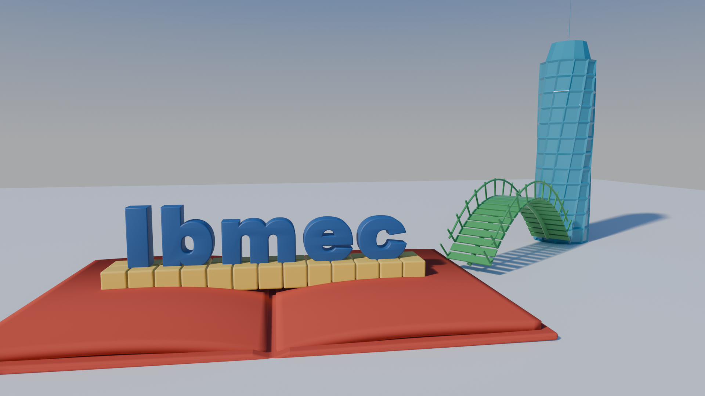
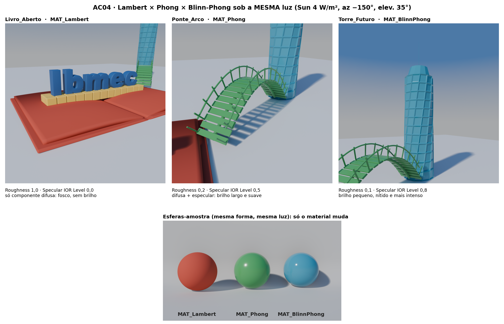
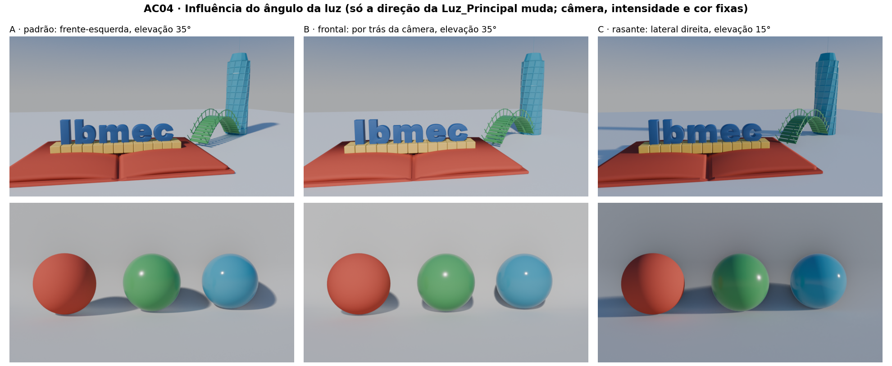

# AC04 — Evolução da Cena: Modelos de Iluminação

**Disciplina:** Computação Gráfica — CG_26.2_8001<br>
**Atividade:** AC04 — Lambert, Phong e Blinn-Phong na cena da AP1 (Blender 4.5 LTS)<br>
**Aluno:** João Pedro Giovanelli Berla

> **Objetivo da atividade:** aplicar e comparar materiais inspirados nos modelos Lambert,
> Phong e Blinn-Phong na cena da AP1, observando as componentes difusa e especular e a
> influência da luz, da rugosidade e do ângulo de observação.

## Entregáveis

| Arquivo | O que é |
|---|---|
| [`AC04_JoaoGiovanelli.blend`](AC04_JoaoGiovanelli.blend) | Cópia evoluída da cena da AP1 (Blender 4.5 LTS): três materiais aplicados, luz configurada, coleções de iluminação e de comparação. O arquivo da AP1 não foi alterado |
| [`imagens/AC04_render_final.png`](imagens/AC04_render_final.png) | Render final pela `CAM_Principal`, 1920 × 1080, EEVEE: "Ibmec" legível e os três objetos autorais visíveis |
| [`imagens/AC04_comparacao_materiais.png`](imagens/AC04_comparacao_materiais.png) | Prancha comparativa: um close de cada objeto autoral e as três esferas-amostra, **todos sob a mesma luz** |
| [`imagens/AC04_estudo_angulo_luz.png`](imagens/AC04_estudo_angulo_luz.png) | Estudo do ângulo da luz: a luz principal girada para três direções (câmera, intensidade e cor fixas) |
| [`AC04_JoaoGiovanelli.py`](AC04_JoaoGiovanelli.py) | Script que abre a cena da AP1, cria materiais, luz e coleções e salva o `.blend` da AC04 |
| [`AC04_renders.py`](AC04_renders.py) · [`montar_paineis.py`](montar_paineis.py) | Scripts que geram os renders e montam as pranchas |
| Este `README.md` | Relatório |



---

## 1. Continuidade da AP1

- O arquivo foi aberto a partir de `AP1/AP1_JoaoGiovanelli.blend` e salvo como **cópia**
  (`AC04_JoaoGiovanelli.blend`). A AP1 continua intacta.
- **Não mudou:** modelagem, composição, câmera principal (`CAM_Principal`, 26 mm, *Track To*
  no `Alvo_Camera`), os três objetos autorais e a palavra **Ibmec**. A palavra mantém o
  material da AP1 (`mat_Ibmec`, azul), sem nenhum teste aplicado a ela. As comparações
  foram feitas só nos objetos autorais, como pede o enunciado.
- **Mudou:**
    - os materiais do livro, da ponte e da torre, que agora usam os materiais de estudo;
    - a luz, que passou a ser a `Luz_Principal`;
    - o fundo (*World*), que ganhou um céu em degradê;
    - a organização das luzes e da comparação no Outliner (seção 6).

## 2. Objetos autorais e materiais aplicados

Cada objeto autoral recebeu **um** dos três materiais. Os objetos que são formados por várias
partes receberam o material em todas elas, para que o objeto inteiro represente um modelo.

| Objeto autoral | Material | Por que este modelo neste objeto |
|---|---|---|
| **`Livro_Aberto`** (capa + `Livro_Paginas`) | **`MAT_Lambert`** | Papel e capa de tecido são superfícies foscas: o livro é o candidato natural à reflexão só difusa. As páginas curvas mostram bem o degradê de N·L |
| **`Ponte_Arco`** (viga, `Ponte_Tabuleiro`, `Ponte_Guarda`, `Ponte_Postes`) | **`MAT_Phong`** | Os tubos do guarda-corpo e da viga cobrem todas as direções de normal, e por isso o brilho especular aparece como uma faixa ao longo deles |
| **`Torre_Futuro`** | **`MAT_BlinnPhong`** | A torre "futurista" pede uma aparência polida. As quinas chanfradas e os peitoris das janelas pegam brilhos pequenos e nítidos, e as faces lisas refletem o céu |

### Valores de cada material (Principled BSDF)

| Parâmetro | `MAT_Lambert` | `MAT_Phong` | `MAT_BlinnPhong` |
|---|---|---|---|
| Base Color (RGB linear) | (0,50; 0,07; 0,05) — vermelho tijolo `#BC4B3F` | (0,05; 0,32; 0,09) — verde `#3F9955` | (0,02; 0,26; 0,40) — azul-petróleo `#278BAA` |
| Roughness | **1,0** | **0,2** | **0,1** |
| Specular IOR Level (no lugar do antigo *Specular*) | **0,0** | **0,5** | **0,8** |
| IOR | 1,5 | 1,5 | 1,5 |
| Metallic | 0 | 0 | 0 |
| Diffuse Roughness | 0 (difusa lambertiana pura) | 0 | 0 |
| Coat / Sheen | 0 | 0 | 0 |

No Blender 4.5 o *Principled BSDF* não tem mais o campo `Specular`. O controle equivalente
é o **`Specular IOR Level`**. Em 0,5 ele não altera o IOR e a refletância especular em
incidência normal fica em cerca de 4% (IOR 1,5). Em 0 o reflexo especular some. Valores
acima de 0,5 aumentam esse reflexo. Os valores seguem os pontos de partida do enunciado:
1,0/0,0, 0,2/0,5 e 0,1/0,8. Com eles a diferença já ficou visível sem estourar as áreas
claras, porque a transformada de cor **AgX** comprime os realces.

## 3. Iluminação

| Luz | Configuração |
|---|---|
| **`Luz_Principal`** (Sun) | Força **4 W/m²**, cor levemente quente (1,0; 0,96; 0,90). Ângulo do disco **3°**, o que dá sombras definidas com borda levemente suave. A luz vem da **frente-esquerda** da câmera, com azimute −150° e **elevação 35°** |
| Preenchimento | Nenhuma luz extra. O preenchimento vem do **World**: um céu em degradê (horizonte `#EDF1F6` → zênite `#6199E5`, força 0,55) que clareia as sombras e dá aos materiais polidos algo para refletir |

**Por que Sun:** a luz Sun tem raios paralelos e não perde intensidade com a distância.
O livro, a uns 17 m da câmera, e a torre, a uns 29 m, recebem exatamente a mesma
irradiância. Isso deixa a comparação justa. Com uma luz Area ou Point, a torre receberia
menos luz só por estar mais longe.

**Por que frente-esquerda a 35°:** a elevação média produz sombras perceptíveis no chão e
entre as letras e os blocos sem deixar a frente da palavra escura. O ângulo lateral faz cada
objeto ter um lado iluminado e um lado em sombra, o que mostra o degradê difuso, e coloca os
brilhos especulares voltados para a câmera.

**Render:** EEVEE (Blender 4.5), 64 amostras, *ray tracing* ligado (reflexos de tela) e
sombras com 2 raios e 8 passos. Saída em 1920 × 1080, transformada de cor **AgX** com o
*look* *Base Contrast*. A luz, a câmera e as configurações ficaram iguais em todas as
imagens comparativas.

## 4. Comparação dos materiais (mesma luz)



Os closes vêm das câmeras `CAM_AC04_Livro`, `CAM_AC04_Ponte` e `CAM_AC04_Torre`. As esferas
vêm da `CAM_AC04_Amostras`. Todas as imagens usam a mesma luz e o mesmo céu. As **esferas
iguais** isolam o efeito do material: como a forma é a mesma, toda diferença vem do shader.

| | Lambert (livro) | Phong (ponte) | Blinn-Phong (torre) |
|---|---|---|---|
| **Brilho especular** | Ausente | Presente, moderado | Presente, mais intenso |
| **Área do *highlight*** | — | Grande e de borda suave (rugosidade 0,2 espalha o lóbulo) | Pequena e nítida, quase um ponto (rugosidade 0,1) |
| **Aparência** | Fosca. O tom depende só do ângulo entre a normal e a luz (N·L): a página virada para a luz é mais clara e a cor escurece de forma contínua até a sombra | Acetinada. A forma continua lida pela difusa e o brilho aparece como faixas claras ao longo dos tubos do guarda-corpo e da viga | Polida. As faces refletem o degradê do céu (mais azul no alto da torre) e os chanfros das janelas fazem pequenos brilhos intensos |
| **Muda com o ponto de vista?** | Não: a difusa não depende de V | Sim: o brilho fica onde R·V é máximo | Sim: o brilho fica onde N·H é máximo |

**Observações:**

- No Lambert o sombreamento é totalmente explicado por `I = kd · (N·L)`. Por isso o livro
  parece igual de qualquer ângulo de câmera, e só a luz muda a sua aparência.
- Entre Phong e Blinn-Phong, a diferença visível vem da **rugosidade** e do nível
  especular. Quanto menor a rugosidade, menor e mais forte o brilho, porque a mesma energia
  refletida se concentra num lóbulo mais estreito.
- **Detalhe teórico:** com o **mesmo** expoente *n*, o Blinn-Phong produz um brilho **maior**
  que o Phong, porque o ângulo entre N e H é cerca de metade do ângulo entre R e V. Para
  ficarem parecidos, o Blinn-Phong precisa de um expoente cerca de 4 vezes maior. Os valores
  usados aqui, com rugosidade menor no Blinn-Phong, vão nessa direção, e por isso o brilho
  da torre ficou mais concentrado que o da ponte.
- Nas superfícies verticais da torre o brilho do sol quase não aparece. Com o sol a 35° e a
  câmera quase na horizontal, o vetor médio H fica inclinado uns 20° para cima, e as faces
  verticais da torre não estão alinhadas com ele. O que se vê nas faces lisas é o **reflexo
  do céu**. O brilho nítido aparece só nos chanfros e peitoris inclinados, cujas normais
  ficam perto de H.

## 5. Influência do ângulo da luz



A `Luz_Principal` foi girada **temporariamente** para três direções. A câmera, a intensidade
e a cor ficaram fixas. No fim, a luz voltou à configuração A, a da imagem final.

| Direção | O que acontece |
|---|---|
| **A — padrão** (frente-esquerda, 35°) | Sombreamento equilibrado. Nas esferas, o brilho do Phong e do Blinn-Phong fica no quadrante superior esquerdo, entre a luz e a câmera |
| **B — frontal** (atrás da câmera, 35°) | A luz chega quase na direção da visão: N·L é alto em quase toda a superfície visível, a imagem "achata" e as sombras ficam escondidas atrás dos objetos. Os brilhos vão para o **centro** das esferas, porque R e V quase coincidem. É a pior luz para ler volume |
| **C — rasante** (lateral direita, 15°) | Sombras longas: a sombra da torre atravessa o livro inteiro. O terminador do Lambert passa para o meio da esfera, e o relevo das páginas e das letras fica evidente. Os brilhos vão para a **borda** das esferas e o efeito Fresnel cresce: em ângulos rasantes até o material fosco reflete um pouco mais |

**Conclusão:** a componente difusa só depende da direção da luz, enquanto a especular
depende da luz **e** do observador. Mover a luz mudou a posição dos brilhos nos materiais
polidos e a distribuição de claro e escuro em todos eles. No Lambert, só esta última mudou.
Para a cena final foi escolhida a direção A, que mantém a palavra iluminada de frente e
mostra volume e brilho nos três objetos.

## 6. Nota técnica — aproximações, não equações clássicas

O **Principled BSDF** do Blender 4.5 é um shader **baseado em princípios físicos**. Ele **não
implementa literalmente** as equações clássicas
`I = ka + kd·(N·L) + ks·(R·V)^n` (Phong) e `I = ka + kd·(N·L) + ks·(N·H)^n` (Blinn-Phong).
Os materiais `MAT_Phong` e `MAT_BlinnPhong` são **aproximações visuais** para comparação:

- não existe expoente de brilho *n*. A largura do brilho vem da **rugosidade** de uma
  distribuição de microfacetas (GGX);
- não existem coeficientes `kd` e `ks` independentes. A divisão entre difusa e especular
  vem do **Fresnel**, calculado a partir do IOR e do `Specular IOR Level`, com conservação
  de energia: o que é refletido especularmente não volta como difusa;
- não existe termo ambiente `ka`. A luz "ambiente" vem do *World*, que ilumina a cena de
  todas as direções;
- a distribuição GGX é escrita em função do **vetor médio H** (N·H). Conceitualmente, o
  Principled está mais perto do Blinn-Phong que do Phong, mas inclui sombreamento e
  mascaramento das microfacetas, o que nenhum dos dois modelos clássicos tem.

Já o `MAT_Lambert` fica bem próximo do modelo original. Com `Specular IOR Level` = 0 e
`Diffuse Roughness` = 0, o Principled fica só com a componente difusa lambertiana. O mesmo
resultado sairia do nó `Diffuse BSDF` com rugosidade 0.

## 7. Organização da cena (Outliner)

```
AP1_Ibmec_Conceito
├─ 01_Palavra              Ibmec_Palavra → Ibmec_I, _b, _m, _e, _c   (mat_Ibmec, da AP1)
├─ 02_Objetos_Autorais     Livro_Aberto → Livro_Paginas               (MAT_Lambert)
│                          Ponte_Arco → Tabuleiro, Guarda, Postes     (MAT_Phong)
│                          Torre_Futuro                               (MAT_BlinnPhong)
├─ 03_Auxiliares           Blocos_Construcao, Chao
├─ 04_Camera               CAM_Principal, Alvo_Camera
├─ 05_Storyboard           CAM_SB_01/02/03 (da AP1)
├─ 06_AC04_Iluminacao      Luz_Principal (Sun)
└─ 07_AC04_Comparacao      CAM_AC04_Livro/Ponte/Torre, CAM_AC04_Amostras,
                           Amostra_Lambert/Phong/BlinnPhong, Amostras_Fundo
```

- A coleção `07_AC04_Comparacao` fica **desligada no render** (`hide_render`), para que o
  F12 mostre só a cena. O script de renders liga essa coleção quando usa as câmeras dela.
  As esferas ficam longe do enquadramento principal, atrás e à esquerda da câmera.
- Os materiais da AP1 que deixaram de ser usados (`mat_Livro_*`, `mat_Ponte_*`,
  `mat_Torre_*`) não foram salvos no arquivo da AC04.

## 8. Checklist do enunciado

| Requisito | Onde está |
|---|---|
| Cópia `AC04_NomeSobrenome.blend` sem sobrescrever a AP1 | `AC04_JoaoGiovanelli.blend`. O script salva com outro nome |
| Ideia, composição e leitura de "Ibmec" preservadas | Seção 1 e `AC04_render_final.png` |
| Materiais e luzes organizados em coleções | Seção 7 (`06_AC04_Iluminacao`, `07_AC04_Comparacao`) |
| Luz principal com áreas iluminadas e sombras | Seção 3 (Sun, 35°) |
| `MAT_Lambert`, `MAT_Phong`, `MAT_BlinnPhong`, um por objeto autoral | Seção 2 |
| Render de teste no modo Rendered | `imagens/` (EEVEE) |
| Comparação sob a mesma luz | Seção 4 e `AC04_comparacao_materiais.png` |
| Investigar o ângulo da luz e restaurar | Seção 5 e `AC04_estudo_angulo_luz.png` |
| Nota sobre as aproximações no Principled BSDF | Seção 6 |

## 9. Como reproduzir

1. Abrir `AP1/AP1_JoaoGiovanelli.blend` no Blender 4.5 LTS → aba **Scripting** → *Open*
   [`AC04_JoaoGiovanelli.py`](AC04_JoaoGiovanelli.py) → **Run Script**. O script salva
   `AC4/AC04_JoaoGiovanelli.blend`.
2. Renders: `blender -b AC4/AC04_JoaoGiovanelli.blend --python AC4/AC04_renders.py`.
3. Pranchas: `python AC4/montar_paineis.py` (requer `matplotlib`).

## 10. Referências

- Enunciado da AC04 e roteiros da Aula 11 (Lambert, Phong, Blinn-Phong) — CG_26.2_8001.
  <https://jonh-carvalho.github.io/CG_26.2_8001/Avalia/AC04/>
- Blender Foundation. *Blender 4.5 LTS Manual*: Principled BSDF; Lights (Sun); EEVEE;
  Color Management. <https://docs.blender.org/manual/en/4.5/>
- PHONG, B. T. Illumination for computer generated pictures. *Communications of the ACM*,
  v. 18, n. 6, 1975.
- BLINN, J. F. Models of light reflection for computer synthesized pictures. *SIGGRAPH '77*,
  1977.
- WALTER, B. et al. Microfacet models for refraction through rough surfaces (GGX).
  *Eurographics Symposium on Rendering*, 2007.
