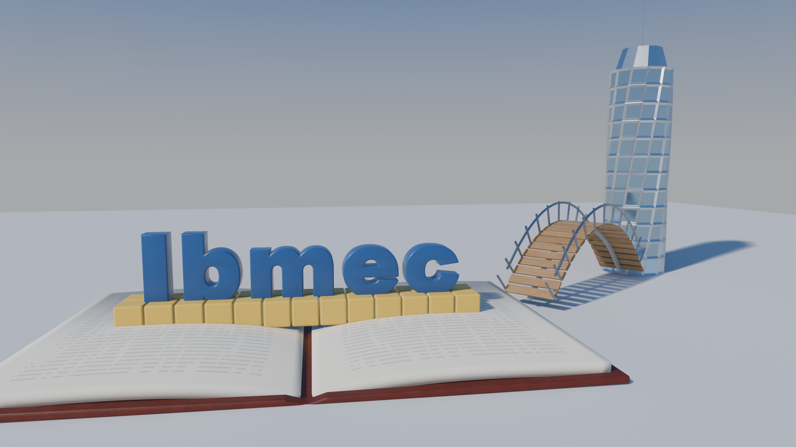
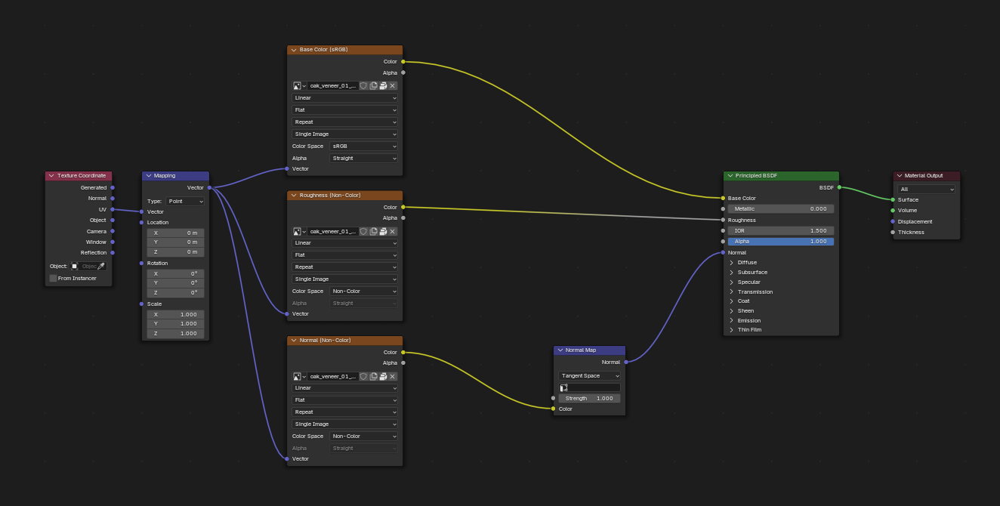
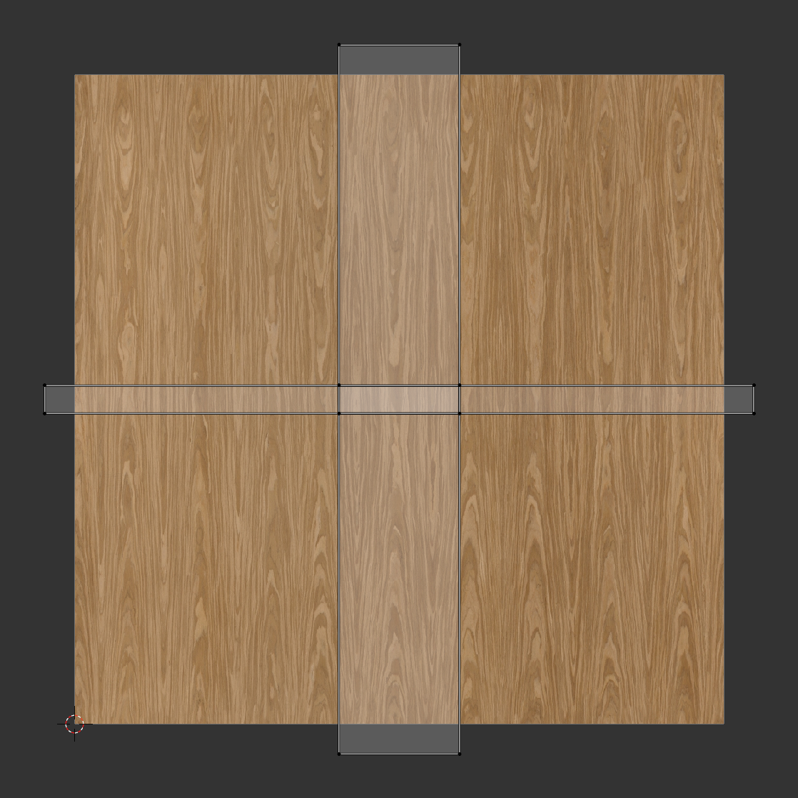
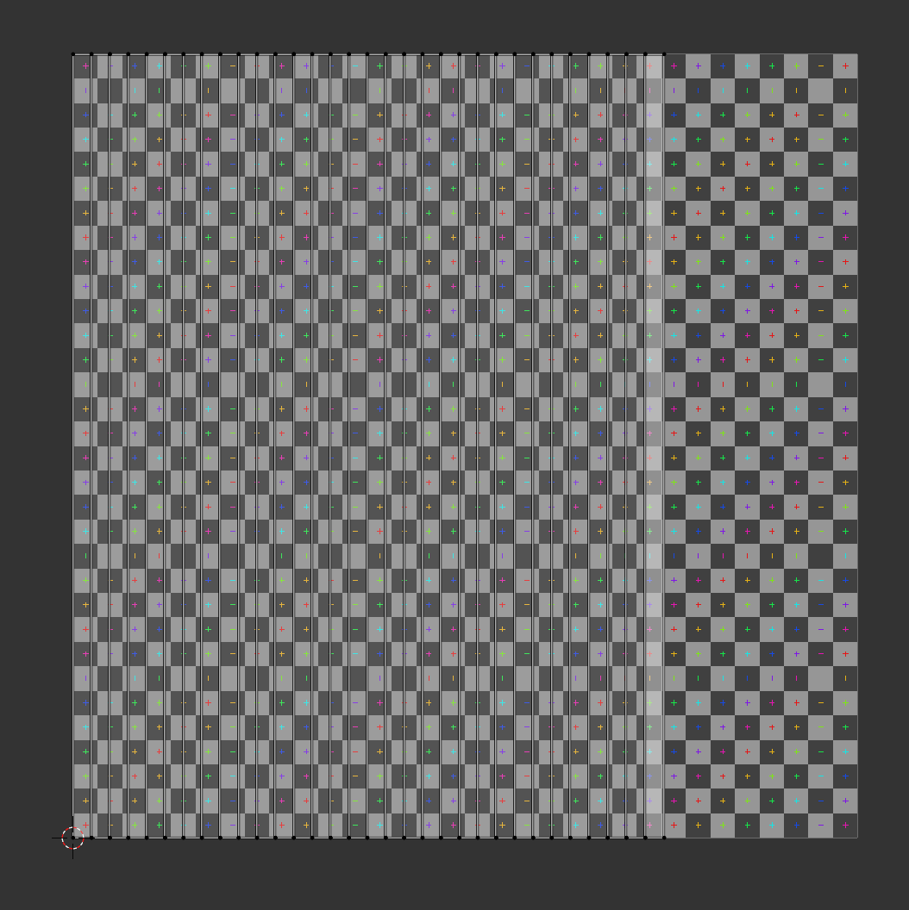
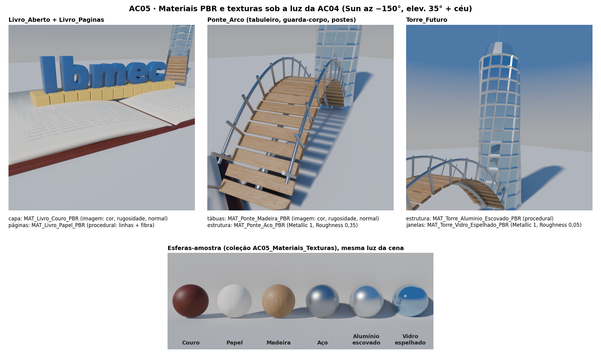
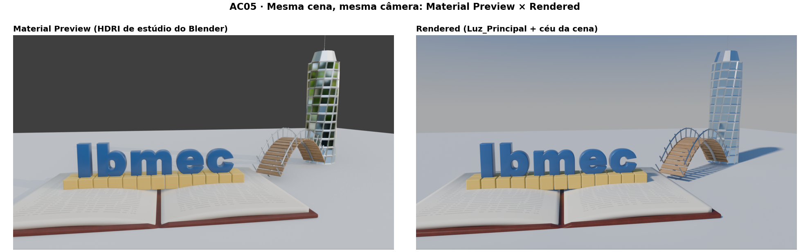

# AC05 — Evolução da Cena: Materiais PBR e Texturas

**Disciplina:** Computação Gráfica — CG_26.2_8001<br>
**Atividade:** AC05 — materiais PBR, UVs e texturas na cena da AP1/AC04 (Blender 4.5 LTS)<br>
**Aluno:** João Pedro Giovanelli Berla

> **Objetivo da atividade:** criar materiais baseados em princípios físicos (Principled BSDF),
> preparar UVs, aplicar texturas de imagem com mapas de cor, rugosidade e normal, e observar
> como os materiais respondem à iluminação da cena, preservando a composição e a palavra
> **Ibmec**.

## Entregáveis

| Arquivo | O que é |
|---|---|
| [`AC05_JoaoGiovanelli.blend`](AC05_JoaoGiovanelli.blend) | Cópia evoluída da AC04 com materiais PBR, UVs e texturas. **As imagens estão empacotadas no `.blend`** (*Pack Resources*). Os arquivos da AP1 e da AC04 não foram alterados |
| [`imagens/AC05_render_final.png`](imagens/AC05_render_final.png) | Render pela câmera principal (`CAM_Principal`), 1920 × 1080, EEVEE |
| [`imagens/AC05_shader_madeira.png`](imagens/AC05_shader_madeira.png) | **Captura do Shader Editor**: `MAT_Ponte_Madeira_PBR` com Base Color, Roughness e Normal (via Normal Map) |
| [`imagens/AC05_shader_couro.png`](imagens/AC05_shader_couro.png) | Shader Editor: `MAT_Livro_Couro_PBR` (o mesmo conjunto de mapas na capa do livro) |
| [`imagens/AC05_uv_tabua.png`](imagens/AC05_uv_tabua.png) | **Captura do UV Editor**: ilhas do `Ponte_Tabuleiro` sobre a imagem da madeira |
| [`imagens/AC05_uv_paginas.png`](imagens/AC05_uv_paginas.png) | UV Editor: `Livro_Paginas` sobre uma grade UV, para conferir a distorção |
| [`imagens/AC05_detalhes_texturas.png`](imagens/AC05_detalhes_texturas.png) | Closes dos três objetos e esferas-amostra dos materiais |
| [`imagens/AC05_material_preview_x_rendered.png`](imagens/AC05_material_preview_x_rendered.png) | O mesmo enquadramento em *Material Preview* e em *Rendered* |
| [`texturas/`](texturas) | As 6 imagens usadas (Poly Haven, CC0), as mesmas que estão empacotadas |
| [`AC05_JoaoGiovanelli.py`](AC05_JoaoGiovanelli.py) | Script que abre a AC04, cria os materiais e as UVs, empacota as imagens e salva a AC05 |
| [`AC05_renders.py`](AC05_renders.py) · [`AC05_capturas_interface.py`](AC05_capturas_interface.py) · [`montar_paineis.py`](montar_paineis.py) | Renders, capturas da interface e montagem das pranchas |



---

## 1. Continuidade da AP1 e da AC04

- `AC05_JoaoGiovanelli.blend` foi salvo a partir do arquivo da AC04. **AP1 e AC04 continuam
  intactos.** O arquivo da AC04 ainda guarda os materiais Lambert, Phong e Blinn-Phong e a
  comparação.
- **Preservados:**
    - a composição, a câmera principal (`CAM_Principal`, 26 mm) e o enquadramento;
    - a palavra **Ibmec** e os três objetos autorais;
    - a iluminação da AC04 (`Luz_Principal` Sun 4 W/m², azimute −150°, elevação 35°, e o
      céu em degradê). **A luz não foi alterada nesta etapa.**
- **Trocados:** os materiais de estudo da AC04 deram lugar a materiais PBR com nomes
  descritivos (seção 2).
- **Palavra "Ibmec":** recebeu `MAT_Ibmec_Azul_PBR`, com a **mesma cor da AP1**
  (RGB linear 0,02; 0,10; 0,32 → `#275999`). O material é um plástico com verniz leve
  (*Coat* 0,25), **sem textura nem relevo**. A leitura e a identidade da marca ficaram iguais.

## 2. Materiais PBR

O enunciado pede materiais "que pareçam metal, madeira e espelho". Cada objeto autoral
recebeu pelo menos um material desses grupos:

| Objeto autoral | Material | Tipo | Base Color | Roughness | Metallic | Outros |
|---|---|---|---|---|---|---|
| **`Livro_Aberto`** (capa) | `MAT_Livro_Couro_PBR` — couro | **imagem** | mapa `leather_red_03` (sRGB) | mapa de rugosidade (Non-Color) | 0 | Normal: mapa `nor_gl` → *Normal Map* (força 1,0) |
| `Livro_Paginas` | `MAT_Livro_Papel_PBR` — papel | procedural | creme `#EFEBDF` + linhas de "texto" `#7C7C86` | 0,85 | 0 | *Specular IOR Level* 0,4. Normal: *Noise* (escala 180) → *Bump* (0,08), a fibra do papel |
| **`Ponte_Tabuleiro`** (tábuas) | `MAT_Ponte_Madeira_PBR` — **madeira** | **imagem** | mapa `oak_veneer_01` (sRGB) | mapa de rugosidade (Non-Color) | 0 | Normal: mapa `nor_gl` → *Normal Map* (força 1,0) |
| `Ponte_Arco`, `Ponte_Guarda`, `Ponte_Postes` | `MAT_Ponte_Aco_PBR` — **metal** (aço) | cor sólida | `#ADB1B6` (0,42; 0,44; 0,47) | 0,35 | **1** | — |
| **`Torre_Futuro`** (estrutura) | `MAT_Torre_Aluminio_Escovado_PBR` — **metal** escovado | procedural | `#E7EAED` (0,80; 0,82; 0,85) | 0,18 a 0,38 (ruído) | **1** | Riscos horizontais: *Noise* em coordenadas de objeto esticado 120× em Z → *Map Range* → Roughness |
| `Torre_Futuro` (144 janelas) | `MAT_Torre_Vidro_Espelhado_PBR` — **espelho** azulado | cor sólida | `#ADD1EF` (0,42; 0,64; 0,86) | **0,05** | **1** | *Emission* preparada com força 0, para a AP2 acender as janelas |
| `Ibmec_*` (5 letras) | `MAT_Ibmec_Azul_PBR` | cor sólida | `#275999` (cor da AP1) | 0,32 | 0 | *Coat* 0,25 (rugosidade do coat 0,15) |
| `Blocos_Construcao` | `MAT_Blocos_Plastico_PBR` | cor sólida | `#F9CE50` (cor da AP1) | 0,38 | 0 | plástico de brinquedo |
| `Chao` | `MAT_Chao_PBR` | cor sólida | `#DADDE1` | 0,85 | 0 | — |

**Valores coerentes com PBR:**

- *Metallic* = 1 só nos metais (aço, alumínio e o vidro espelhado, que se comporta como
  espelho metálico). Todo o resto é dielétrico, com *Metallic* = 0.
- Nos metais a *Base Color* é a cor do **reflexo**, porque metal não tem difusa. Nos
  dielétricos ela é a cor difusa.
- A rugosidade controla a nitidez dos reflexos. Na escala de 0 a 1, o espelho fica em 0,05, o
  aço em 0,35, o couro varia pelo mapa e o papel fica em 0,85.

**Janelas da torre:** a torre tem dois slots de material. As 144 faces de janela (12 andares
× 12 lados) receberam o índice 1. Elas foram identificadas pela geometria criada na AP1: as
faces que o *inset* afundou são laterais, têm área maior que 0,15 m² e ficam abaixo da coroa.

## 3. Mapas, conexões e espaço de cor



O mesmo arranjo foi usado na madeira (acima) e no couro
([captura](imagens/AC05_shader_couro.png)):

```
Texture Coordinate (UV) → Mapping ─┬→ Image Texture "Base Color (sRGB)"      → Base Color ┐
                                   ├→ Image Texture "Roughness (Non-Color)"  → Roughness  ├→ Principled BSDF → Material Output
                                   └→ Image Texture "Normal (Non-Color)" → Normal Map (Tangent) → Normal ┘
```

| Mapa | Espaço de cor | Por quê |
|---|---|---|
| Base Color / Albedo | **sRGB** | É uma cor: o arquivo está em sRGB e o Blender converte para linear |
| Roughness | **Non-Color** | É um dado (0 a 1). Converter como cor distorceria os valores |
| Normal | **Non-Color** | Os canais RGB guardam as direções XYZ da normal. Passa pelo nó **Normal Map** (espaço tangente) antes da entrada `Normal` |

- Os mapas normais usados são a versão **OpenGL** (`nor_gl`), que é a convenção do Blender
  (Y para cima). A versão DirectX deixaria o relevo invertido.
- Não foi usado mapa *Metallic*. O couro e a madeira são dielétricos (0 constante) e os
  metais da cena não têm imagem.

## 4. UVs

| Objeto | Método | Ajustes contra distorção e repetição |
|---|---|---|
| `Livro_Aberto` (capa) | **Cube Projection** (`cube_size` 2,5) | A capa é uma caixa com lombada: a projeção cúbica dá a cada face a projeção do eixo dominante, sem esticar. Todas as faces usam a mesma escala (1 ladrilho = 2,5 m), então a densidade da textura é **uniforme**. O couro da amostra mede 0,3 m: a escala foi aumentada para o grão aparecer no livro "gigante" (15 m) sem virar manchas |
| `Ponte_Tabuleiro` (tábua) | **Cube Projection** (`cube_size` 1,83) | 1 ladrilho = 1,83 m, o **tamanho real** da amostra de carvalho. A face de cima da tábua cai numa ilha estreita e vertical, e o **veio** (vertical na imagem) fica ao longo do **comprimento** da tábua, como numa tábua de verdade. Para não repetir o mesmo desenho, o `Array` usa **`offset_u = 0,37`**: cada cópia lê outra faixa da imagem |
| `Livro_Paginas` | **Unwrap (Angle Based)** | A página é uma faixa curva desenvolvível (um perfil extrudado), então a planificação não tem distorção: vira um retângulo de 0 a 0,75 em U e de 0 a 1 em V. Na grade UV os quadrados continuam quadrados. As linhas de "texto" procedurais usam essas UVs e seguem a curvatura da página |



Na captura acima, as ilhas laterais da tábua se sobrepõem às de cima. Isso é proposital
na projeção cúbica com textura **repetível**: a imagem não tem detalhes únicos, então duas
faces podem ler a mesma região sem erro visível. A regra de evitar sobreposição vale para
texturas pintadas à mão ou *bake*, em que cada ponto do modelo precisa de um pixel próprio.



- **Torre e estrutura metálica da ponte** usam material procedural em coordenadas de
  **objeto**, ou cor sólida, e por isso não precisam de UV.
- **Conferência:** os closes da seção 6 foram usados para checar escala, orientação,
  distorção e repetição. O veio segue as tábuas, as tábuas não são iguais entre si e não há
  costura visível na capa.

## 5. Origem e licença das texturas externas

| Textura | Autor | Fonte | Licença | Mapas usados (1K, JPG) |
|---|---|---|---|---|
| **Leather Red 03** | Rob Tuytel | <https://polyhaven.com/a/leather_red_03> | **CC0** (domínio público) | `coll1` (cor), `rough`, `nor_gl` |
| **Oak Veneer 01** | Jenelle van Heerden | <https://polyhaven.com/a/oak_veneer_01> | **CC0** (domínio público) | `diff` (cor), `rough`, `nor_gl` |

As 6 imagens estão **empacotadas** no `.blend` (*File › External Data › Pack Resources*).
Uma cópia está na pasta [`texturas/`](texturas) e o caminho salvo é relativo
(`//texturas/...`), então o arquivo abre em outro computador sem caminho quebrado. O papel,
o alumínio escovado e o vidro são **procedurais ou de cor sólida** (seção 2), sem imagem
externa.

## 6. Revisão e influência da iluminação





- **Metais dependem do ambiente.** Aço, alumínio e espelho não têm componente difusa: a cor
  que se vê é o que eles refletem.
    - No *Rendered*, com o céu da cena, o vidro da torre fica azul, porque reflete o céu, e o
      aço da ponte fica claro, porque reflete o chão claro.
    - No *Material Preview*, o HDRI padrão do Blender (uma floresta) muda totalmente o
      reflexo. As janelas espelhadas mostram o verde das árvores e as sombras da
      `Luz_Principal` desaparecem.
    - Os dielétricos (couro, madeira, papel, plástico) mudam bem menos entre os dois modos:
      a cor-base deles continua a mesma.
- **Mapas de rugosidade e normal aparecem com luz lateral.** Com o sol a 35° vindo da
  esquerda, o relevo do couro e o veio da madeira aparecem como variação no brilho
  especular. De frente, quase só a cor-base aparece. Por isso a luz da AC04, lateral e com
  elevação média, foi mantida.
- **A sombra ajuda a ler as superfícies.** A sombra do guarda-corpo sobre o chão e a das
  letras sobre os blocos revelam a forma. O papel, fosco e claro, mostra bem essas sombras
  sem competir com a palavra.
- **"Ibmec" continua legível.** O material quase fosco (*Roughness* 0,32), com verniz leve,
  dá um reflexo suave nas bordas arredondadas da letra, sem esconder a cor da marca.

## 7. Organização (Outliner)

```
AP1_Ibmec_Conceito
├─ 01_Palavra              Ibmec_Palavra → Ibmec_I, _b, _m, _e, _c   (MAT_Ibmec_Azul_PBR)
├─ 02_Objetos_Autorais     Livro_Aberto (Couro) → Livro_Paginas (Papel)
│                          Ponte_Arco (Aço) → Ponte_Tabuleiro (Madeira), Ponte_Guarda, Ponte_Postes (Aço)
│                          Torre_Futuro (Alumínio escovado + Vidro espelhado)
├─ 03_Auxiliares           Blocos_Construcao (Plástico), Chao
├─ 04_Camera               CAM_Principal, Alvo_Camera
├─ 05_Storyboard           CAM_SB_01/02/03
├─ 06_AC04_Iluminacao      Luz_Principal
└─ AC05_Materiais_Texturas CAM_AC05_Livro/Ponte/Torre (closes), CAM_AC05_Amostras,
                           Amostra_PBR_* (6 esferas), Amostras_Fundo
```

A coleção auxiliar `AC05_Materiais_Texturas` tem o nome pedido no enunciado e fica fora do
render principal (F12).

## 8. Checklist dos requisitos

| Requisito | Onde está |
|---|---|
| 1. Blender 4.5 LTS, cópia da cena da AC04 | `AC05_JoaoGiovanelli.blend`, gerado a partir da AC04 |
| 2. Composição da AP1/AC04, "Ibmec" e três objetos preservados | Seção 1 e render final |
| 3. Principled BSDF nos três objetos autorais | Seção 2 |
| 4. UVs nos objetos texturizados; imagem em pelo menos dois | Seção 4. Imagens no livro (couro) e na ponte (madeira) |
| 5. Base Color + Roughness + Normal em pelo menos um material | Seção 3: madeira **e** couro |
| 6. Espaço de cor dos mapas de dados e nó Normal Map | Seção 3 |
| 7. "Ibmec" íntegra, sem textura | Seção 1 (`MAT_Ibmec_Azul_PBR`) |
| 8. Materiais organizados e imagens empacotadas | Seções 5 e 7 |
| Captura do Shader Editor | `imagens/AC05_shader_madeira.png`, `AC05_shader_couro.png` |
| Captura do UV Editor | `imagens/AC05_uv_tabua.png`, `AC05_uv_paginas.png` |

## 9. Como reproduzir

1. Abrir `AC4/AC04_JoaoGiovanelli.blend` → **Scripting** → *Open*
   [`AC05_JoaoGiovanelli.py`](AC05_JoaoGiovanelli.py) → **Run Script**. O script carrega as
   imagens de `AC5/texturas/`, cria materiais e UVs, empacota as imagens e salva o
   `AC5/AC05_JoaoGiovanelli.blend`.
2. Renders: `blender -b AC5/AC05_JoaoGiovanelli.blend --python AC5/AC05_renders.py`.
3. Capturas de interface (abre a janela do Blender e fecha sozinho):
   `blender AC5/AC05_JoaoGiovanelli.blend --python AC5/AC05_capturas_interface.py`.
4. Recortes e pranchas: `python AC5/montar_paineis.py` (requer `matplotlib` e `Pillow`).

## 10. Referências

- Enunciado da AC05 e material da Aula 12 (Materiais, Texturas, UV Unwrapping, Texturas no
  Blender) — CG_26.2_8001. <https://jonh-carvalho.github.io/CG_26.2_8001/Avalia/AC05/>
- Blender Foundation. *Blender 4.5 LTS Manual*: Principled BSDF; Image Texture; Normal Map;
  UV Unwrapping (Cube Projection, Unwrap); Color Management; Pack Resources.
  <https://docs.blender.org/manual/en/4.5/>
- Poly Haven — texturas PBR CC0. <https://polyhaven.com/textures>
- BURLEY, B. *Physically-Based Shading at Disney*. SIGGRAPH Course Notes, 2012 (base do
  Principled BSDF).
