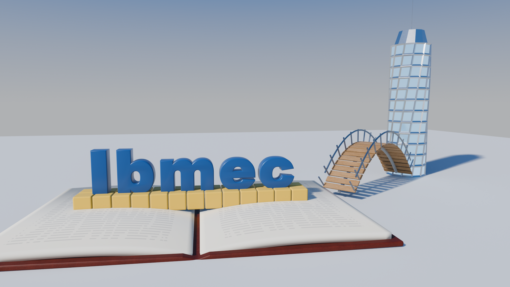
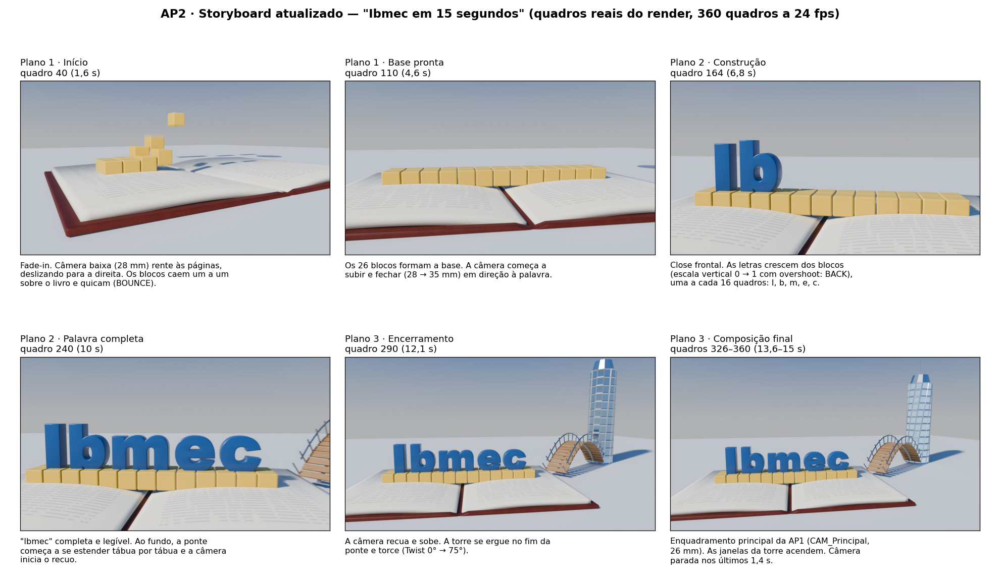
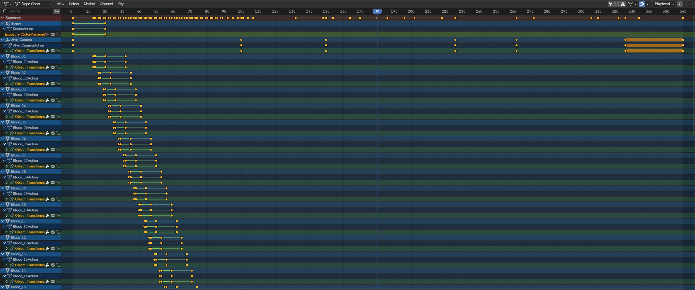
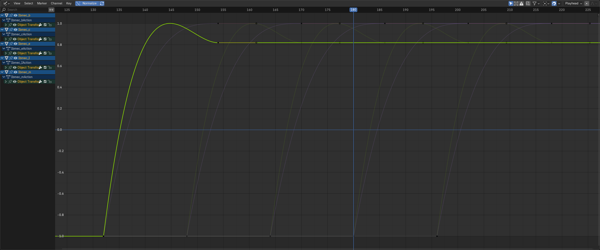
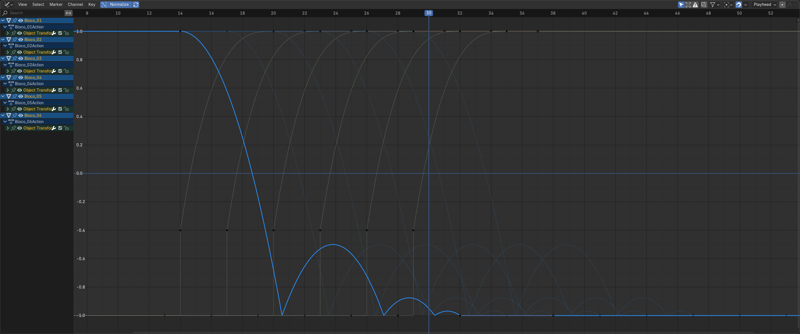
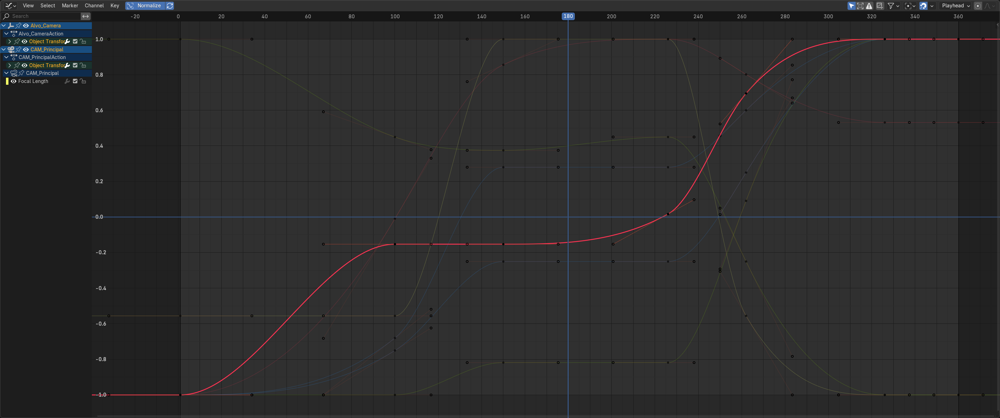

# AP2 — Peça Audiovisual "Ibmec em 15 segundos"

**Disciplina:** Computação Gráfica — CG_26.2_8001<br>
**Atividade:** AP2 — animação, iluminação, materiais, render e exportação (Blender 4.5 LTS)<br>
**Aluno:** João Pedro Giovanelli Berla

> **Título da peça:** *Ibmec: Construindo o Futuro*. É a finalização da cena da AP1, com a
> iluminação estudada na AC04 e os materiais PBR e texturas da AC05.

## Entregáveis

| Arquivo | O que é |
|---|---|
| [`AP2_JoaoGiovanelli.mp4`](AP2_JoaoGiovanelli.mp4) | **Vídeo final**: 15,0 s, 24 fps, 360 quadros, 1920 × 1080, MPEG-4 / **H.264** (High, yuv420p), sem áudio |
| [`AP2_JoaoGiovanelli.blend`](AP2_JoaoGiovanelli.blend) | Cena com animações, materiais, texturas **empacotadas**, iluminação, câmera e saída configurada (FFmpeg MPEG-4 H.264, frames 1–360, 24 fps) |
| [`imagens/AP2_quadro_final.png`](imagens/AP2_quadro_final.png) | Quadro final renderizado (quadro 360) |
| [`imagens/AP2_quadro_0240.png`](imagens/AP2_quadro_0240.png) | Quadro representativo (quadro 240: palavra completa, ponte começando) |
| [`storyboard/storyboard_ap2.png`](storyboard/storyboard_ap2.png) | **Storyboard atualizado**, com quadros reais do render (seção 3) |
| [`imagens/AP2_dopesheet.png`](imagens/AP2_dopesheet.png), `AP2_graph_*.png` | Capturas do Dope Sheet e do Graph Editor (timing e interpolação) |
| [`AP2_JoaoGiovanelli.py`](AP2_JoaoGiovanelli.py) | Script que abre a AC05, ajusta a cena para a animação, cria os keyframes e salva a AP2 |
| [`AP2_render.py`](AP2_render.py) · [`AP2_capturas_interface.py`](AP2_capturas_interface.py) · [`storyboard/montar_storyboard.py`](storyboard/montar_storyboard.py) | Render dos quadros, capturas da interface e montagem do storyboard |
| Este `README.md` (e [`AP2_JoaoGiovanelli_relatorio.pdf`](AP2_JoaoGiovanelli_relatorio.pdf)) | Relatório |



---

## 1. Conceito e resumo da sequência

A ideia vem da AP1: **o conhecimento é a base sobre a qual se constrói o futuro**. Um
**livro aberto gigante** é o chão da cena. Sobre ele, **blocos de construção** caem e formam o
alicerce. A palavra **Ibmec** **cresce** a partir desses blocos, letra por letra. Depois,
uma **ponte** se estende da borda do livro até uma **torre torcida** que se ergue e acende as
janelas. A frase visual é **conhecimento → construção → caminho → futuro**, e a marca é
apresentada como algo **construído**, não apenas mostrado.

**Resumo em 15 s:**

1. A imagem surge do escuro e mostra o livro.
2. Blocos caem um a um sobre as páginas.
3. A câmera fecha na base e as letras I-b-m-e-c sobem, uma após a outra, com um pequeno
   "salto".
4. A palavra completa ganha destaque. A câmera recua e sobe, e no caminho a ponte se
   desenha tábua por tábua.
5. A torre se ergue e torce no fim da ponte, e as janelas acendem.
6. A peça termina parada no enquadramento principal da AP1, com "Ibmec" em destaque.

## 2. Planos e ações animadas

A peça é um **plano-sequência**: uma câmera só, sem cortes, passando pelos três momentos do
storyboard da AP1. As câmeras `CAM_SB_*` da AP1 serviram de referência para as poses-chave
da `CAM_Principal`.

| Plano | Quadros (tempo) | Ação | Câmera |
|---|---|---|---|
| **1 — Início** | 1–120 (0–5 s) | *Fade-in* (quadros 1–20). Os **26 blocos** aparecem e caem 2,6 m sobre o livro, quicando, da esquerda para a direita e alternando as duas fileiras. Um bloco começa a cada 3 quadros (14 → 89) e o último pousa no quadro 107 | Baixa (z ≈ 2 m), 28 mm, rente às páginas, **deslizando para a direita** (pose da `CAM_SB_01`) |
| **2 — Construção da palavra** | 121–264 (5–11 s) | As letras **crescem a partir dos blocos**, uma a cada 16 quadros (I 132, b 148, m 164, e 180, c 196). Cada uma leva 22 quadros, com *overshoot*. A partir do quadro 196, **a ponte começa a se estender** do livro em direção à torre | Sobe e fecha para 35 mm em **close frontal** na palavra (pose da `CAM_SB_02`, quadro 150). Acompanha as letras para a direita e, no quadro 226, começa a recuar |
| **3 — Encerramento** | 265–360 (11–15 s) | A ponte termina (tábuas até 272, guarda-corpo e postes até 280). A **torre se ergue** (262–306) e **torce** (272–322). As **janelas acendem** (310–334) | **Recua e sobe** até o enquadramento principal da AP1 (`CAM_Principal`, 26 mm) no quadro 326 e fica **parada** até 360 (1,4 s) |

"Ibmec" fica inteira e legível do quadro ≈ 218 até o fim, no close e no plano geral.

## 3. Storyboard atualizado



**Mudanças em relação ao storyboard da AP1**, todas para melhorar a animação sem mudar a
proposta:

| AP1 | AP2 | Motivo |
|---|---|---|
| Três momentos com câmeras de referência (`CAM_SB_01` → `02` → `03` → `CAM_Principal`) | Um movimento contínuo da `CAM_Principal` que passa pelas poses de `SB_01` e `SB_02` e **termina direto** na `CAM_Principal`, sem ir até a `SB_03` | Em 4 s, recuar até a `SB_03` (z = 12 m) e voltar à `CAM_Principal` (z = 5,2 m) seriam dois movimentos opostos e bruscos. Indo direto, a câmera "recua e sobe" uma vez e para |
| Blocos "surgem um a um" | Blocos **caem** com quique (BOUNCE) | Dá peso e ritmo ao começo e reforça a ideia de "construção" |
| Ponte se estende "ao fundo" durante o plano 2 | Ponte começa no fim do plano 2 (196) e termina no plano 3 (280) | No close de 35 mm a área da ponte fica fora do quadro. Atrasar a ponte faz o crescimento acontecer enquanto a câmera recua e a revela |
| — | *Fade-in* no início e **janelas que acendem** no fim | Abertura e fechamento mais claros: a torre "liga" quando o futuro fica pronto |

## 4. Propriedades animadas, timing e interpolação

| Elemento | Propriedade animada | Quadros | Interpolação (Graph Editor) | Decisão |
|---|---|---|---|---|
| Cena | `view_settings.exposure` −5 → 0 | 1–20 | SINE, *ease out* | *Fade-in* rápido sem corte seco |
| `Bloco_01` … `Bloco_26` | `location.z` +2,6 m → 0 | início 14 + 3k, duração 18 | **BOUNCE**, *ease out* | Queda acelerada com 3 quiques que perdem altura, como num objeto real. O ritmo de 3 quadros forma uma "onda" da esquerda para a direita |
| | `scale` 0 → 0,3 → 1 | início −1 → início → +6 | CONSTANT → CUBIC *ease out* | O bloco "nasce" no alto da queda, sem aparecer de repente já pousado |
| `Ibmec_I`, `_b`, `_m`, `_e`, `_c` | `scale.y` 0 → 1 | início 132 + 16i, duração 22 | **BACK**, *ease out* (back = 1,7): passa de 1 e volta | A letra "salta" para fora do bloco. Y local é o eixo vertical da letra, porque a palavra está girada 90° em X e a origem de cada letra está na base (preparado na AP1) |
| | `scale.x` e `scale.z` 0,75 → 1 | mesmos | CUBIC *ease out* | Leve expansão lateral, para a letra não parecer só "esticada" |
| `Ponte_Arco`, `_Tabuleiro`, `_Guarda`, `_Postes` | `hide_render`, `hide_viewport` | 1 → 196 | CONSTANT | A ponte não existe antes da hora |
| `Ponte_Arco` (curva) | `bevel_factor_end` 0 → 1 | 196–262 | SINE *ease in-out* | A viga do arco "é desenhada" do livro até a torre |
| `Ponte_Guarda` (curva) | `bevel_factor_end` 0 → 1 | 214–280 | SINE *ease in-out* | Guarda-corpo segue a viga com atraso de 18 quadros (*overlapping action*) |
| `Ponte_Tabuleiro` | `Array_tabuas.fit_length` 0,4 → 9,405 m | 204–272 | **LINEAR** | Ritmo constante: 22 tábuas em 68 quadros, uma nova a cada ≈ 3 quadros, "tábua por tábua" |
| `Ponte_Postes` | `Array_postes.fit_length` 0,4 → 9,405 m | 214–280 | LINEAR | Postes acompanham o guarda-corpo |
| `Torre_Futuro` | `scale.z` 0 → 1,1 | 262–306 | **BACK** *ease out* | A torre cresce rápido e "assenta" com um pequeno *overshoot* |
| | `SimpleDeform_twist.angle` 0° → 75° | 272–322 | SINE *ease in-out* | Torção suave: o futuro "girando" até a forma final |
| `MAT_Torre_Vidro_Espelhado_PBR` | `Emission Strength` 0 → 0,7 | 310–334 | SINE *ease in-out* | As janelas acendem no fim |
| `CAM_Principal` | `location` e `lens` (28 → 35 → 28 → 26 mm) | chaves em 1, 100, 150, 226, 262, 326, 360 | **BEZIER**, alças *auto clamped* | Acelera e desacelera sem passar do ponto. As chaves 326 e 360 iguais criam a parada final |
| `Alvo_Camera` (alvo do *Track To*) | `location` | mesmas chaves | BEZIER *auto clamped* | A câmera sempre olha para o alvo, e o alvo anda junto com a ação |



| Escala das letras (BACK, normalizado) | Z dos blocos (BOUNCE, normalizado) |
|---|---|
|  |  |



**Revisão no Graph Editor:**

- **Letras:** a curva BACK sobe além de 1 e volta, o *overshoot* esperado.
- **Blocos:** a curva BOUNCE mostra os quiques decrescentes.
- **Câmera:** as curvas da câmera e do alvo não têm picos nem inversões. As alças
  *auto clamped* não deixam a curva ultrapassar os valores das chaves, o que evita "voltar
  para trás" entre poses.
- **Problema encontrado:** no primeiro teste a câmera girava rápido demais no recuo e
  cortava o "I". A chave do quadro 262 foi recalculada para manter dentro do campo de visão
  a palavra (que ocupa até 26,6° do eixo, com metade do FOV de 32,7° a 28 mm), a ponte e a
  base da torre.

## 5. Ajustes de modelagem para a animação

O enunciado permite ajustar a modelagem quando isso melhora a animação. Foram três ajustes,
e nenhum muda a aparência final:

1. **Blocos:** na AP1 eram **um** objeto com `Array X × Array Y`. Com Array não dá para animar
   cada bloco separado, então eles viraram **26 objetos** (`Bloco_01`…`Bloco_26`) que
   **compartilham a mesma malha** (*linked duplicates*). Os blocos são filhos do Empty
   `Blocos_Construcao`, que ficou na mesma posição e rotação do objeto original. A origem de
   cada bloco está no centro da base, o ponto certo para quicar e escalar.
2. **Ponte:** os Arrays das tábuas e dos postes passaram de *Fit Curve* para *Fit Length*,
   cujo comprimento pode ser animado. No fim da animação o comprimento é o da curva
   (9,405 m), e a ponte fica igual à da AP1. As curvas usam *bevel factor mapping* = *Spline*,
   para a viga crescer de forma uniforme ao longo do arco.
3. **Limpeza:** a coleção auxiliar da AC05 (esferas-amostra e câmeras de detalhe) saiu do
   arquivo da AP2. Ela continua no arquivo da AC05.

## 6. Iluminação e renderização

**Iluminação:** é a mesma estudada e escolhida na AC04 e usada na AC05.

- **`Luz_Principal`** é uma luz Sun que vem da frente-esquerda (azimute −150°, elevação 35°,
  disco de 3°). Ela ilumina a frente da palavra, projeta sombras legíveis (letras sobre os
  blocos, guarda-corpo no chão, torre) e coloca os brilhos dos metais voltados para a câmera.
  Por ser uma luz de raios paralelos, a iluminação não muda quando a câmera se move por
  15 m de cena.
- **Preenchimento:** o World, um céu em degradê com força 0,55, que também é o que os metais
  e o vidro refletem.
- **Ajuste final para o vídeo:** força do sol de 4 para **4,5 W/m²** e *look* **AgX — Medium
  High Contrast**, porque a imagem estava acinzentada em movimento.
- **Acento:** emissão azul nas janelas da torre no fim.
- O Principled BSDF é **baseado em princípios físicos**, e os estudos de Lambert, Phong e
  Blinn-Phong da AC04 serviram para entender difusa e especular. Os materiais finais **não
  são** implementações dessas equações clássicas.

**Renderização:**

| Item | Configuração |
|---|---|
| Motor | **EEVEE** (Blender 4.5 LTS), 48 amostras, *ray tracing* ligado (reflexos), sombras suaves |
| *Motion blur* | Ligado, *shutter* 0,5 (meio quadro): suaviza a queda dos blocos e o recuo da câmera |
| Formato | 1920 × 1080, **24 fps**, quadros **1–360** (15 s), AgX |
| Saída no `.blend` | **FFmpeg → MPEG-4 → H.264**, qualidade *High*, `//AP2_JoaoGiovanelli.mp4`. *Render › Render Animation* (Ctrl+F12) gera o MP4 direto |
| Como o vídeo entregue foi feito | Os 360 quadros foram renderizados em **PNG** ([`AP2_render.py`](AP2_render.py)), o que permite retomar se o render parar. Levou 256 s numa RTX 4060 Ti, ≈ 0,7 s por quadro. Os PNG foram codificados em **H.264** com o ffmpeg (libx264, perfil High, nível 4.1, CRF 18, yuv420p, cor BT.709, 24 fps). O nível 4.1 e as tags de cor garantem que o vídeo toque nos players do Windows: na primeira codificação o x264 escolheu o nível 5.0 e o Media Player não reproduziu |
| Testes antes do final | 15 quadros-chave em 50% de resolução para checar enquadramento e timing. Esse teste mostrou o corte do "I" e o brilho estourado das janelas, ambos corrigidos |
| Verificação do MP4 | `ffprobe`: H.264 High, 1920 × 1080, 24 fps, **360 quadros, 15,000 s**. O vídeo foi conferido do início ao fim, com uma folha de contato de 1 quadro a cada 8 extraída do próprio MP4 |

## 7. Materiais e texturas (reaproveitados da AC05)

| Objeto | Material (da AC05) | Ajuste na AP2 |
|---|---|---|
| `Livro_Aberto` / `Livro_Paginas` | `MAT_Livro_Couro_PBR` (imagem: cor + rugosidade + normal) / `MAT_Livro_Papel_PBR` (procedural) | Nenhum. As linhas de "texto" do papel foram conferidas em quadros consecutivos do movimento rasante do plano 1: o *anti-aliasing* do EEVEE as mantém estáveis, sem cintilação |
| `Ponte_Tabuleiro` / estrutura | `MAT_Ponte_Madeira_PBR` (imagem: cor + rugosidade + normal) / `MAT_Ponte_Aco_PBR` | Nenhum. Como a ponte cresce tábua por tábua, a repetição da madeira ficaria evidente. O `offset_u` do Array (AC05) faz cada tábua nova mostrar outro veio |
| `Torre_Futuro` | `MAT_Torre_Aluminio_Escovado_PBR` + `MAT_Torre_Vidro_Espelhado_PBR` | **Emissão** do vidro animada (0 → 0,7) com cor azul (0,35; 0,68; 1,0). Com 1,6 as janelas estouravam para branco no teste |
| `Ibmec_*` | `MAT_Ibmec_Azul_PBR` (cor da AP1, sem textura) | Nenhum. A identidade da marca ficou igual |
| Blocos / chão | `MAT_Blocos_Plastico_PBR` / `MAT_Chao_PBR` | Nenhum. Os 26 blocos compartilham o material |

- Os mapas de dados (rugosidade e normal) continuam em **Non-Color** e os normais passam
  pelo nó **Normal Map**.
- As 6 imagens estão **empacotadas** no `.blend`, com caminho relativo de referência para
  `AC5/texturas/`.

## 8. Desafios e soluções

| Desafio | Solução |
|---|---|
| Animar os blocos um a um, sendo que na AP1 eram um único objeto com Array | Separar em 26 *linked duplicates* sob um Empty no mesmo lugar (seção 5) |
| Fazer a ponte "crescer" ao longo do arco | Arrays em *Fit Length* com `fit_length` animado (tábuas e postes) e `bevel_factor_end` das curvas (viga e guarda-corpo) |
| Fazer as letras crescerem **a partir dos blocos**, e não do centro | Origem de cada letra na base (feito na AP1). Animação de `scale.y`, o vertical local da letra |
| Recuo da câmera cortando o "I" (teste em baixa resolução) | Nova chave no quadro 262, calculada pelo campo de visão para manter palavra, ponte e torre no quadro |
| Janelas acesas estourando para branco | Emissão de 1,6 para 0,7 e cor azulada |
| Imagem acinzentada no vídeo | *Look* AgX Medium High Contrast e sol a 4,5 W/m² |
| Risco de perder o render no meio | Sequência PNG retomável, depois codificada em H.264 |
| Primeiro MP4 não tocava no Media Player do Windows (o x264 escolheu o nível 5.0) | Nova codificação com perfil High, nível 4.1 e tags de cor BT.709, a partir dos mesmos quadros |

## 9. Organização da cena (Outliner)

```
AP1_Ibmec_Conceito
├─ 01_Palavra            Ibmec_Palavra → Ibmec_I, _b, _m, _e, _c        (escala animada)
├─ 02_Objetos_Autorais   Livro_Aberto → Livro_Paginas
│                        Ponte_Arco → Ponte_Tabuleiro, Ponte_Guarda, Ponte_Postes   (crescem)
│                        Torre_Futuro                                   (ergue, torce, acende)
├─ 03_Auxiliares         Blocos_Construcao (Empty) → Bloco_01 … Bloco_26 (caem), Chao
├─ 04_Camera             CAM_Principal (Track To → Alvo_Camera), Alvo_Camera   (animadas)
├─ 05_Storyboard         CAM_SB_01/02/03 (referência da AP1, não renderizam)
└─ 06_AC04_Iluminacao    Luz_Principal
```

## 10. Checklist dos requisitos técnicos

| Requisito | Onde está |
|---|---|
| 1. 15 s a 24 fps, quadros 1–360 | `.blend` (1–360, 24 fps) e MP4 (360 quadros, 15,000 s) |
| 2. Câmera + pelo menos dois elementos, com "Ibmec" ou objeto autoral | Câmera, letras de "Ibmec", ponte, torre, blocos e janelas (seção 4) |
| 3. "Ibmec" e os três objetos autorais preservados | Seções 1, 5 e quadro final |
| 4. Materiais PBR e texturas da AC05 nos objetos autorais | Seção 7 |
| 5. Iluminação que apoia a narrativa e a leitura | Seção 6 |
| 6. Render completo e MP4 H.264 | `AP2_JoaoGiovanelli.mp4` (seção 6) |
| 7. `.blend` organizado, recursos empacotados | Seções 7 e 9 |
| Keyframes revisados no Graph Editor | Seção 4 (capturas) |
| Storyboard atualizado | Seção 3 |

## 11. Fontes e licenças

| Recurso | Origem | Licença |
|---|---|---|
| Textura **Leather Red 03** (capa do livro) | Poly Haven, Rob Tuytel — <https://polyhaven.com/a/leather_red_03> | CC0 |
| Textura **Oak Veneer 01** (tábuas) | Poly Haven, Jenelle van Heerden — <https://polyhaven.com/a/oak_veneer_01> | CC0 |
| Fonte das letras de "Ibmec" | Arial Black (fonte do sistema Windows), usada **só na AP1** para gerar a forma das letras. O texto foi convertido em malha e o `.blend` não contém o arquivo da fonte | Fonte do sistema, uso acadêmico |
| Modelos, materiais procedurais, animação e scripts | Autorais | — |
| Áudio | Não utilizado | — |

## 12. Como reproduzir

1. Abrir `AC5/AC05_JoaoGiovanelli.blend` → **Scripting** → *Open*
   [`AP2_JoaoGiovanelli.py`](AP2_JoaoGiovanelli.py) → **Run Script**. O script salva
   `AP2/AP2_JoaoGiovanelli.blend`.
2. Vídeo pelo Blender: abrir o `.blend` → *Render › Render Animation* (Ctrl+F12), que gera o
   MP4 direto.<br>
   Ou pelo terminal:
   `blender -b AP2/AP2_JoaoGiovanelli.blend --python AP2/AP2_render.py -- quadros/` e depois
   `ffmpeg -framerate 24 -i quadros/%04d.png -c:v libx264 -profile:v high -level:v 4.1 -crf 18 -pix_fmt yuv420p -colorspace bt709 -color_primaries bt709 -color_trc bt709 -movflags +faststart AP2/AP2_JoaoGiovanelli.mp4`.
3. Capturas: `blender AP2/AP2_JoaoGiovanelli.blend --python AP2/AP2_capturas_interface.py`.
4. Storyboard: `python AP2/storyboard/montar_storyboard.py`.

## 13. Referências

- Enunciado da AP2 e materiais das Aulas 11, 12 e 14 (iluminação, materiais e texturas,
  animação) — CG_26.2_8001. <https://jonh-carvalho.github.io/CG_26.2_8001/Avalia/ap2/>
- Etapas anteriores deste repositório: [AP1](../AP1), [AC04](../AC4), [AC05](../AC5).
- Blender Foundation. *Blender 4.5 LTS Manual*: Keyframes; Graph Editor (interpolação e
  *easing*); Array Modifier (*Fit Length*); Curves (*Bevel Factor*); Simple Deform; EEVEE;
  Motion Blur; Output (FFmpeg). <https://docs.blender.org/manual/en/4.5/>
- THOMAS, F.; JOHNSTON, O. *The Illusion of Life: Disney Animation*. 1981 (*timing*,
  *ease in/out*, *overlapping action*).
